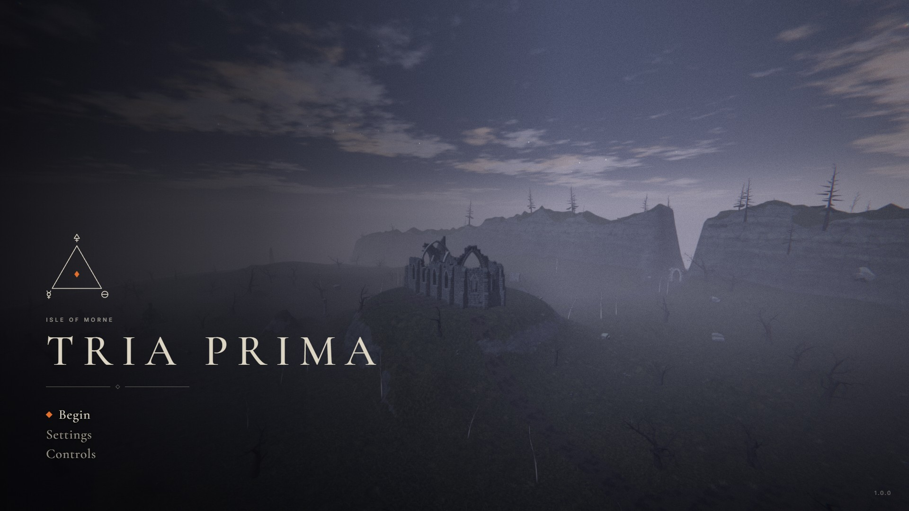
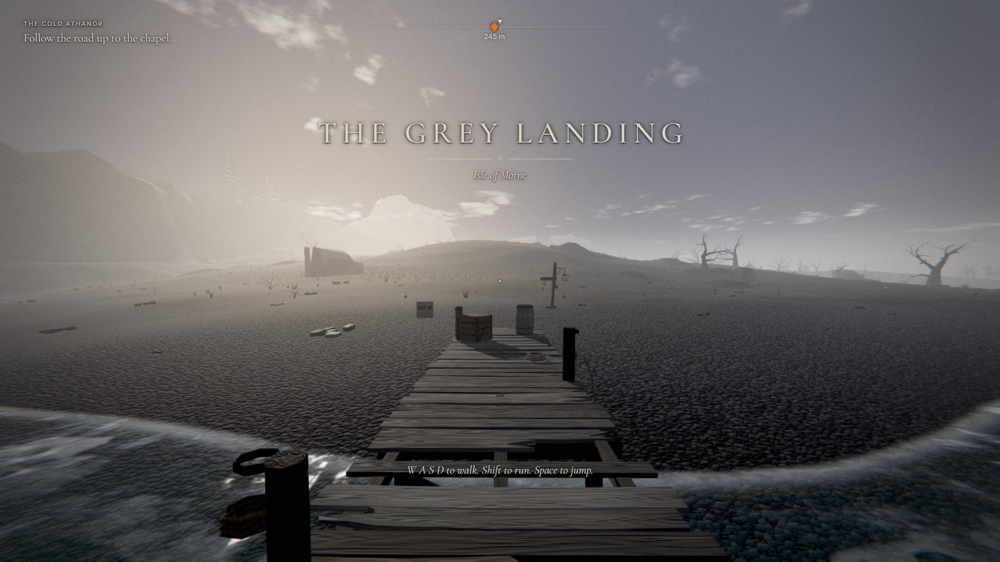
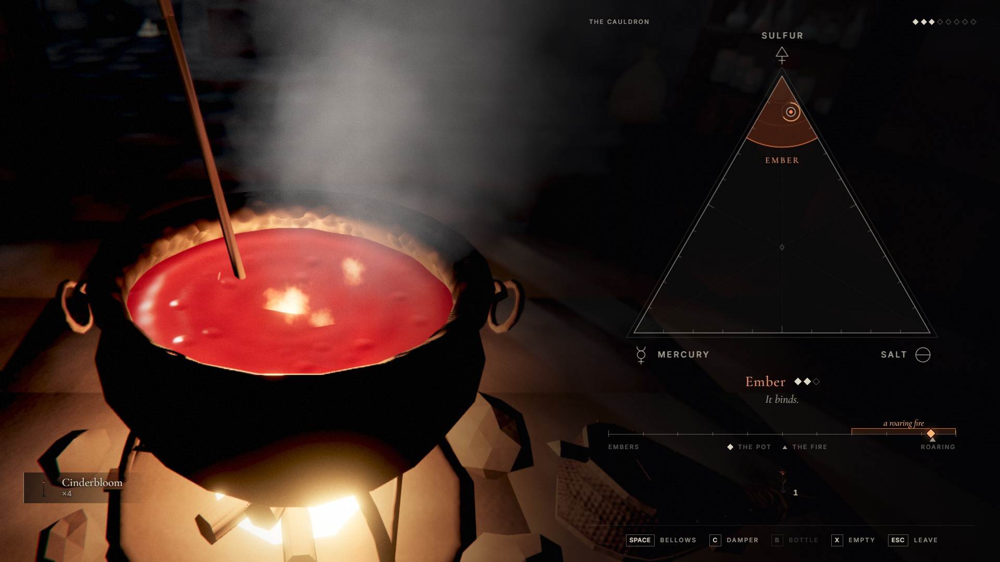
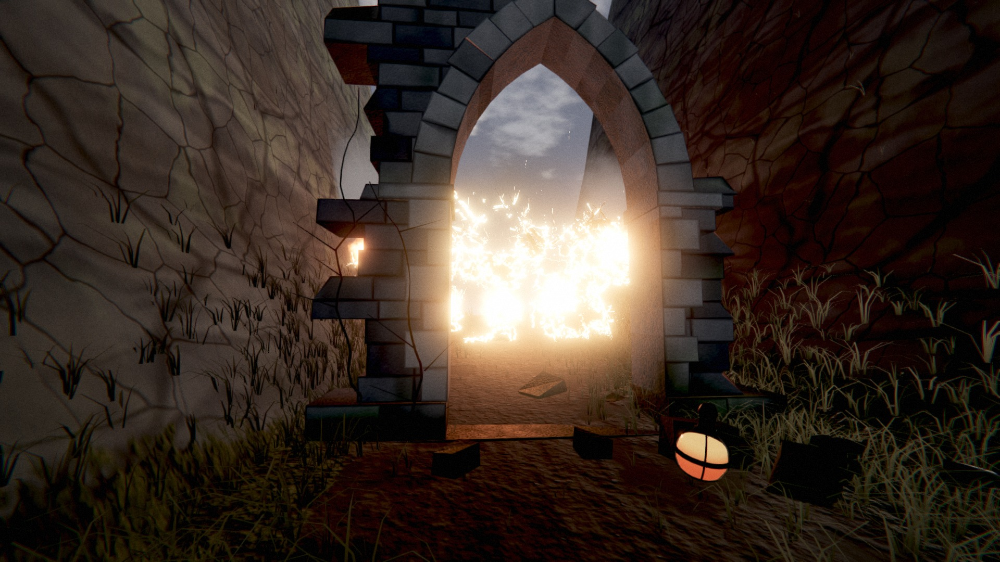
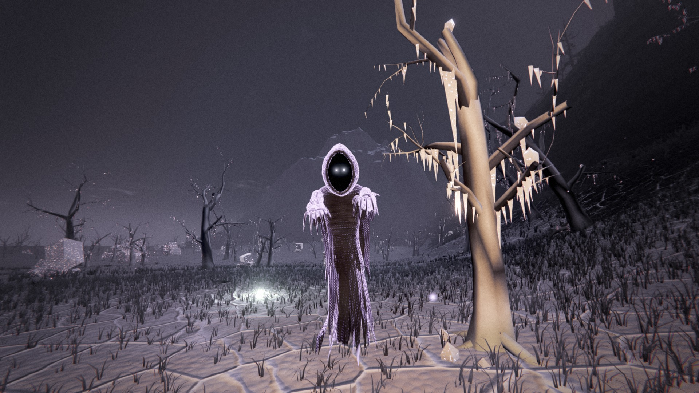
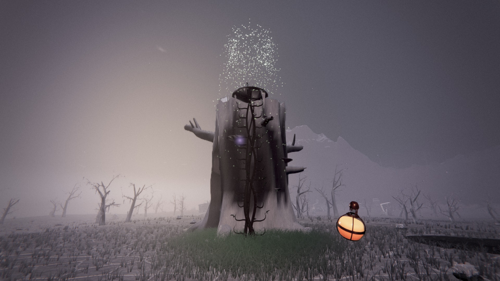
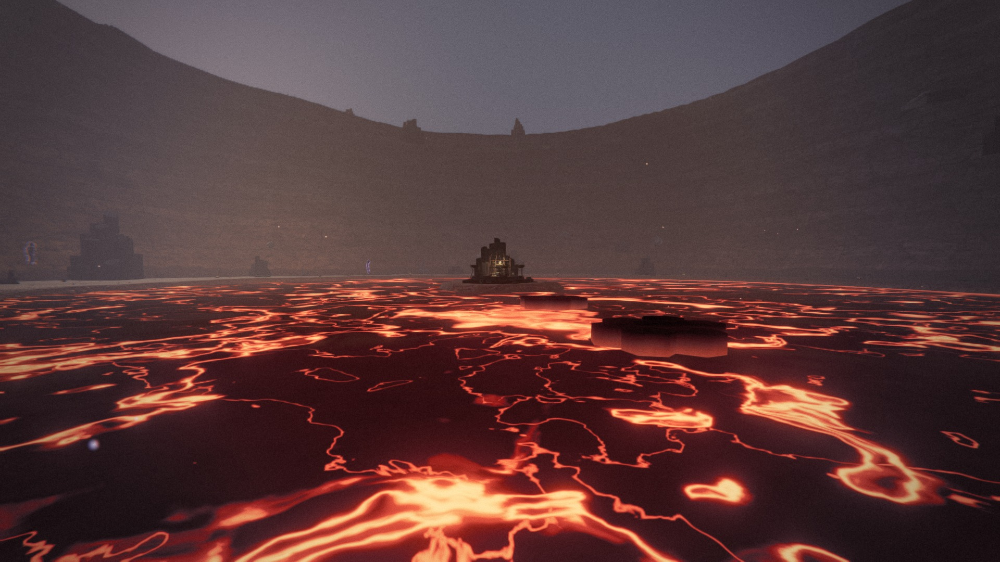

# Tria Prima

A dark-fantasy alchemy adventure in first person, played in the browser.

**Play it: https://winchxyz.github.io/tria-prima/**



The Athanor, the furnace that kept the Isle of Morne alive, has gone cold. The Gloom has come up
out of the ground and the isle is dying under it. You are the last apprentice. Gather what still
grows, brew it in the ruined chapel, and use what you brew to reach the three Primes (Salt,
Mercury, Sulfur) that lie where the Gloom is thickest. Unite them in the Great Work and relight
the fire.

It needs a keyboard, a mouse and a graphics card (WebGL 2). A full run takes about an hour.

## What you do

- **Gather.** Nine ingredients grow, crust and smoulder in their own corners of the isle.
- **Brew.** Every mixture is a point inside a triangle whose corners are Sulfur, Mercury and Salt.
  Each ingredient pulls the mixture toward itself. Bring the mark into a potion's region, bring the
  fire into its heat band with bellows and damper, stir until it binds, bottle it.
- **Throw.** Each of the seven potions is a verb that changes the world, and each one opens new
  ground: Ember burns briar and lights the lanterns of the dead, Verdance wakes a seed into a vine
  you can climb, Rime lays ice on water and crust on lava, Levity lifts what is heavy, Fulminate
  breaks cracked stone, Saltspire raises a pillar to stand on, Aqua Vitae mends you.
- **Survive the Gloom.** Shades hunt in it. Fire unmakes them, cold holds them still, and a lit
  lantern is somewhere to come back to.

| | |
| --- | --- |
|  |  |
|  |  |
|  |  |

## Controls

| On the isle | |
| --- | --- |
| `W` `A` `S` `D` | Walk |
| `Shift` | Run |
| `Space` | Jump |
| `E` | Use, gather, carry |
| Mouse | Throw. Hold to aim |
| `F` | Drink |
| `Q`, `1`–`7` | Next potion, choose a potion |
| `Tab` | The book: journal, chart, herbal, the pages you find |
| `M` | The map |
| `P` | Photo mode |
| `Esc` | Pause |

| At the cauldron | |
| --- | --- |
| Mouse | Stir. Circle over the pot |
| `Space` | Bellows. Hold |
| `C` | Damper. Hold |
| `B` | Bottle |
| `X` | Empty the pot |
| `Esc` | Leave |

The game saves by itself at lanterns and when you leave. Quality adapts to the machine; it can
also be set by hand in Settings, or forced with `?q=low`, `?q=medium`, `?q=high` or `?q=ultra`.

## How it is made

Everything is generated in code when the page loads. There are no model, texture or sound files;
the only assets are two fonts.

- **Rendering.** WebGL 2 through three.js, with the engine's own shaders on top: a sky with a sun,
  a moon, stars and drifting cloud that drives the light of every hour; height fog with light
  shafts; cascaded shadows; water with reflection, foam and depth colour; lava; a terrain shader
  that blends eight ground layers by slope, height and region; wind-blown grass; particles;
  a mask the potions paint on the ground (scorch, frost, growth); an HDR pipeline
  with bloom, exposure metering, tone mapping, colour grading, vignette and grain.
- **World.** One island about 640 m across, from a seeded heightmap with a carved river, a lake, a
  caldera and a mountain. About a hundred procedural models, most in several seeded variants,
  built from a small kit: the chapel and its Athanor, ruins, lanterns, shrines, dead trees, rocks,
  plants, bottles, Shades.
- **Physics.** cannon-es for loose bodies (crates, barrels, rubble, thrown phials) and a character
  controller written for the game (walking, running, jumping, swimming, climbing, standing on
  what the potions make).
- **Sound.** Synthesised with the Web Audio API: weather and places, fire, water, footsteps by
  surface, the cauldron, the Shades.
- **Score.** Eleven written pieces, one for each place and state, on one motif: a vielle, a
  flute, a lute, a horn, voices, bells and drums, all synthesised. The notes are in
  `src/audio/score.js` as plain text (keys, chords, a line for each player); the band in
  `src/audio/music.js` reads them and lets players in and out with what is happening.
- **Interface.** DOM and CSS over the canvas: HUD, the brewing chart, the book with its map, menus.

## Run it locally

```bash
npm install
```

```bash
npm run dev
```

Then open `http://localhost:8930/dev/game.html` for the game from source, or
`http://localhost:8930/` for the release page.

```bash
npm run build
```

writes `dist/game.js` (one minified module) and stamps `index.html` with its hash. The page at
the root of this repository is what GitHub Pages serves.

## Layout

| Path | What |
| --- | --- |
| `index.html`, `dist/`, `assets/` | the release: the page, the bundle, the fonts |
| `src/gfx/` | engine: sky, lighting, water, terrain and prop materials, grass, particles, post |
| `src/world/` | the island: heightmap, terrain, placement of everything on it |
| `src/models/` | the procedural model kit and every model |
| `src/game/` | player, potions, brewing, quests, entities, Shades, saving |
| `src/audio/` | the synthesiser, the ambience, the instruments and the written score |
| `src/ui/` | HUD, cauldron, book, menus |
| `dev/` | development pages: model viewer, world viewer, interface and audio benches |
| `tools/` | dev server, release build, scripted play on a real GPU (`tools/play.mjs`), and checks of the sound, the score and the mouse look that need no ears or hands |
| `docs/` | the design and the module contracts |

The scripted play tools need a copy of `playwright-core` and a Chromium; see `tools/pw.mjs`.

## Credits and licence

The game is under the MIT licence, see `LICENSE`.

Built on [three.js](https://threejs.org) (MIT) and [cannon-es](https://github.com/pmndrs/cannon-es)
(MIT); their licence texts are in `dist/THIRD-PARTY-LICENSES.txt`. Type:
[Cormorant Garamond](https://github.com/CatharsisFonts/Cormorant) and
[Inter](https://github.com/rsms/inter), both under the SIL Open Font License; the licence texts
are in `assets/fonts/`.
